<div align="center">

<p align="center"></p>

[](https://github.com/xhthc/MediaLatch/stargazers)
[](CHANGELOG.md)
[](https://github.com/xhthc/MediaLatch)
[](docs/PRIVACY.md)
[](https://t.me/fs0x1337)
[](https://boosty.to/fs0x1337)
[](LICENSE)

[**🇷🇺 Русский**](README.md) | [**🇬🇧 English**](README.en.md)

</div>

<p align="center"></p>

> [!IMPORTANT]
> This is the public home for MediaLatch documentation and future packaged releases. Development source is private. **3.0.0 is in preparation:** a new CRX will follow minification, repacking and verification.

## ⚡ About

**MediaLatch** saves the images, videos and GIFs you select on a page. Use the browser menu or controls on supported sites, follow each file in the download manager, and open saved media in the built-in viewer.

Configure folders, names for new files, notices and optional statistics. No companion app is required. The extension has no backend or telemetry.

<p align="center"></p>

## 🚀 Installation and updates

<p align="center"></p>

New packages will appear in [Releases](https://github.com/xhthc/MediaLatch/releases), with a SHA-256 checksum and file provenance alongside the CRX. **The public 3.0.0 release is not published yet.**

Chrome on Windows/macOS normally uses Chrome Web Store distribution. A self-signed GitHub CRX is not a general installer: browser and managed-installation policies apply. The current store link will be added when that publication is updated.

Loading an unpacked folder, illustrated above, is for local verification of a prepared build. It is a separate Developer mode route and requires the verified runtime folder itself.

> [!TIP]
> Keep the checksum with the CRX. Switching installation channels can change the extension ID and local data. The private `.pem` signing key is not part of the package and is not needed by users.

## 🧩 Features

| Task | Available behavior |
| --- | --- |
| Save selected media | Original-image discovery, progressive MP4/WebM and supported GIFs. Exact signed URLs stay intact. |
| Save a post | Proven batches on X, Reddit, Pixiv, Pawchive and supported VK surfaces, with per-file results and Cancel remaining. |
| Choose a destination | Browser Downloads or an explicitly selected folder. Flat, site and media-type layouts. |
| Name new files | Original basename, optional site/account and UTC publication date/time. Unknown dates are omitted. |
| Preview saved media | Images, animated GIFs and MP4 with playback controls; fit/100%, zoom, pan, carousel buttons, arrow keys and swipe. |
| Track results | Compact popup, full manager, source-page notices, optional local statistics, retry and cancellation. Image/GIF and video filters remain available. |
| Copy preview links | Configurable X, Instagram, TikTok, YouTube video and Shorts links. This does not add YouTube downloading. |
| Adjust the interface | Violet, blue, dark and light themes; English/Russian; keyboard focus and reduced motion. |
| Read release history | Page through bundled versions offline, with an Installed label on the matching version. |

Click a thumbnail in the manager to open the themed viewer. Popup and page-notice thumbnails open it over the active/source page through an isolated extension frame; restricted pages fall back to the manager. Hover previews remain available.

Original previews are local and bounded: 64 MiB per file, 128 MiB total, 16 entries, 24 hours. Older, oversized or evicted files can be chosen from disk. Cache failure never changes a saved file. Codec support follows the browser.

### Folders and filenames

```text
Downloads/
└── SavedImages/
    ├── x/posting_account/pic/2026-10-22_18-35-12_original-name.jpg
    ├── reddit/video/clip.mp4
    └── pixiv/pic/artwork.png
```

The layout is configurable. Account folders name the posting account, which may differ from the artist. Publication dates currently use proven X post data; download time and filenames never stand in for an unknown publication date. Naming choices apply to new saves. Existing files are not renamed.

Collisions receive a suffix, including after history/statistics are cleared. Clearing records does not authorize overwriting files. Long Unicode names may be shortened to satisfy path limits; very deep Windows destinations can still be refused.

<details>
  <summary>Saving settings</summary>
  
</details>

<p align="center"></p>

## 🌐 From selection to file

<p align="center"></p>

The extension binds the action to the selected item and source page, checks the admitted source and file, then exports it. An unproven original from a neighboring post is not a substitute.

## 🌍 Site coverage

Support depends on the selected media, page layout and your access to the source.

| Site or family | Scope |
| --- | --- |
| X / Twitter | Selected images/video, supported MP4 animations to GIF and proven post batches. |
| Reddit | Images, native GIFs, declared progressive video and bounded unencrypted H.264/AAC HLS VOD. |
| Pixiv | Original selected artwork page or its proven page list; account folders. |
| RedGIFs | Selected player media, including supported separate-audio recovery. |
| VK / VK Video | Photos, supported carousels/collages/feed video, preview cards/opened players and native clip downloads. Experimental; wider layout/audio checks remain. |
| TikTok / Instagram | Supported selected-video/Reel controls and posting usernames; separate-track-only feed sources can be unavailable. |
| Pawchive / Sankaku | Declared originals tied to the selected post; partial archive imports remain explicit. |
| Booru families | Selected originals on supported engines, subject to authentication and site limits. |
| Other HTTP(S) pages | Image attributes, source sets, linked metadata and related original links with ownership checks. No universal video resolver. |

DRM, live streams, universal HLS/DASH, arbitrary gallery selection and YouTube downloads are outside the current scope. A 403, expired URL, missing original or unsupported stream is reported as a failure. A neighboring post is not a fallback.

## 🖼️ Interface

These captures show the prepared 3.0.0 UI with locally generated demonstration records and media. They do not establish compatibility with every live site.

<details open><summary>Download manager</summary>


</details>
<details><summary>Statistics, popup and viewer</summary>


</details>

<p align="center"></p>

## 🛡️ Privacy and security

MediaLatch has no extension backend or telemetry. Saving contacts the requested source/provider/CDN. Preferences, queue state, optional statistics, diagnostics and preview caches stay in extension storage. A manual release check contacts GitHub and never installs code.

Source-page notices show bounded result text. Original bytes, directory handles and local paths stay in extension contexts. Reports and diagnostic exports require a user action; review them before sharing. Broad HTTP/HTTPS permissions support selected-media discovery across sites. See the [privacy policy and permission explanations](docs/PRIVACY.md).

Report vulnerabilities privately to [always1337@vk.com](mailto:always1337@vk.com) or [@fs0x1337 on Telegram](https://t.me/fs0x1337). See the [Security Policy](SECURITY.md) for reporting details and testing scope.

## ☕ Support the project

If MediaLatch helps you collect and organize media, you can support development on [Boosty](https://boosty.to/fs0x1337). For questions and ordinary bugs, use [Issues](https://github.com/xhthc/MediaLatch/issues) or [Telegram @fs0x1337](https://t.me/fs0x1337).

## 📜 License

Starting with 3.0.0, project-owned code and artwork use the [proprietary license](LICENSE). Earlier GPL recipients keep their existing rights. Third-party components retain their [licenses and notices](THIRD_PARTY_NOTICES.txt).

This repository contains no extension development source or its Git history. CRX packages contain executable JavaScript; packaging and minification do not make it inaccessible to inspection.

[Changelog](CHANGELOG.md) · [Privacy](docs/PRIVACY.md) · [Security Policy](SECURITY.md) · [Boosty](https://boosty.to/fs0x1337)
