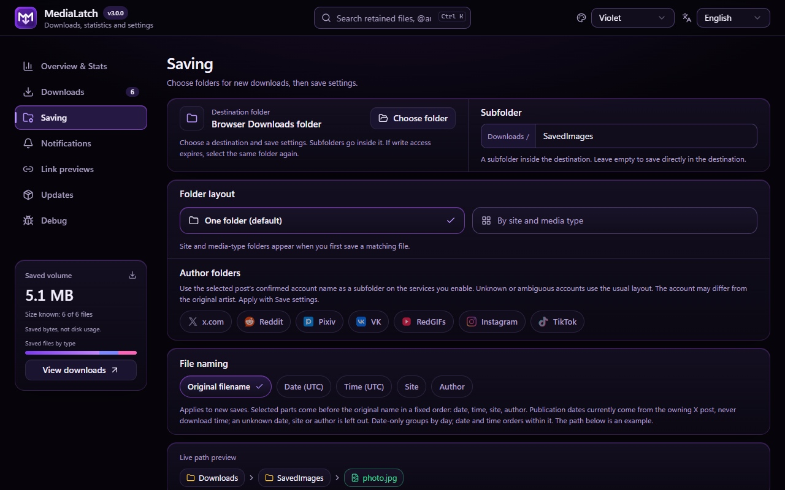

<div align="center">

<p align="center"></p>


[](https://github.com/xhthc/MediaLatch/stargazers)
[](CHANGELOG.md)
[](https://github.com/xhthc/MediaLatch)
[](docs/PRIVACY.md)
[](https://t.me/fs0x1337)
[](https://boosty.to/fs0x1337)
[](LICENSE)

[**🇷🇺 Русский**](README.md) | [**🇬🇧 English**](README.en.md)

</div>

<p align="center"></p>

> [!IMPORTANT]
> This repository contains MediaLatch documentation and future builds. Development source is private. **Version 3.0.0 is in preparation.** A CRX will follow minification, repacking and verification.

## ⚡ About

**MediaLatch** saves the images, videos and GIFs you select on a page. Use the browser menu or controls on supported sites, follow each file in the download manager, and open saved media in the built-in viewer.

Configure folders, names for new files, notices and optional statistics. No companion app is required. The extension has no backend or telemetry.

<p align="center"></p>

## 🚀 Installation and updates

<p align="center"></p>

Packages will appear in [Releases](https://github.com/xhthc/MediaLatch/releases). Each CRX will include a SHA-256 checksum and a list of build files.

Chrome on Windows and macOS normally installs extensions through the Chrome Web Store. Browser and enterprise policies restrict self-signed CRX installation. The store link will be added after the listing is updated.

If your browser permits manual CRX installation, download the package and checksum from the same release. Compare the file's SHA-256 with the published checksum before installing.

> [!TIP]
> Keep the checksum with the CRX. Switching installation channels can change the extension ID and local data. The private `.pem` signing key is not part of the package and is not needed by users.

## 🧩 Features

| Task | Available behavior |
| --- | --- |
| Save selected media | Original-image discovery, progressive MP4/WebM and supported GIFs. Exact signed URLs stay intact. |
| Save a post | Multiple files from posts on X, Reddit, Pixiv, Pawchive and supported VK pages. See each file's result and cancel the remaining downloads. |
| Choose a destination | Browser Downloads or an explicitly selected folder. Flat, site and media-type layouts. |
| Name new files | Original basename, optional site/account and UTC publication date/time. Unknown dates are omitted. |
| Preview saved media | Images, animated GIFs and MP4 with playback controls; fit/100%, zoom, pan, carousel buttons, arrow keys and swipe. |
| Track results | Popup, manager, page notices, optional statistics, retry and cancellation. Filters for images/GIFs and videos. |
| Copy preview links | Configurable X, Instagram, TikTok, YouTube video and Shorts links. This does not add YouTube downloading. |
| Adjust the interface | Violet, blue, dark and light themes; English/Russian; keyboard focus and reduced motion. |
| Read release history | Browse release notes offline, with an Installed label on the matching version. |

Click a thumbnail in the manager to open the viewer. From the popup, it opens over the active tab; from a page notice, it opens over the source page. The viewer runs in an isolated extension frame. On restricted browser pages, it opens in the manager. Small previews appear on hover.

Preview originals are stored locally: 64 MiB per file, 128 MiB total, 16 entries, 24 hours. If a file is too large or no longer cached, choose it from disk. This does not change the saved file. Codec support depends on the browser.

### Folders and filenames

```text
Downloads/
└── SavedImages/
    ├── x/posting_account/pic/2026-10-22_18-35-12_original-name.jpg
    ├── reddit/video/clip.mp4
    └── pixiv/pic/artwork.png
```

The layout is configurable. Account folders use the posting account, which may differ from the artist. Publication dates currently come from verified X post data. If the date is unknown, it is omitted; the download time and filename are not used instead. Naming settings apply to new saves. Existing files are not renamed.

When names match, the extension adds a suffix, even after history and statistics are cleared. Existing files are not overwritten. Long filenames may be shortened to fit path limits. The browser or filesystem may still reject an excessively long Windows path.

<details>
  <summary>Saving settings</summary>
  
</details>

<p align="center"></p>

## 🌐 From selection to file

<p align="center"></p>

The extension finds the selected media's original, checks the source and file, then saves it to the destination folder. It does not substitute a file from a neighboring post.

## 🌍 Site coverage

Support depends on the selected media, page layout and your access to the source.

| Site or family | Scope |
| --- | --- |
| X / Twitter | Images and video, conversion of supported MP4 animations to GIF, and multiple files from a post. |
| Reddit | Images, native GIFs, declared progressive video and bounded unencrypted H.264/AAC HLS VOD. |
| Pixiv | The original of the selected artwork page or its verified page list; account folders. |
| RedGIFs | Selected player media, including supported separate-audio recovery. |
| VK / VK Video | Photos, supported carousels, collages and feed videos, preview cards, opened players and native clip downloads. Experimental; other layouts and audio need further testing. |
| TikTok / Instagram | Supported selected-video/Reel controls and posting usernames; separate-track-only feed sources can be unavailable. |
| Pawchive / Sankaku | Originals linked to the selected post. Incomplete archive imports are marked. |
| Booru families | Selected originals on supported engines, subject to authentication and site limits. |
| Other HTTP(S) pages | Image attributes, srcset, metadata and links to the selected image's original. There is no universal video search. |

DRM, live streams, universal HLS/DASH, arbitrary gallery selection and YouTube downloads are not supported. A 403, expired URL, missing original or unsupported stream is reported as a failure. Files from neighboring posts are not used as a fallback.

## 🖼️ Interface

These screenshots show the 3.0.0 interface with demonstration data. Compatibility with real sites depends on their layout and access to the media.

<details open><summary>Download manager</summary>


</details>
<details><summary>Statistics, popup and viewer</summary>


</details>

<p align="center"></p>

## 🛡️ Privacy and security

MediaLatch has no backend or telemetry. Downloads contact the selected site, service or CDN. Settings, the queue, optional statistics, diagnostics and preview caches stay in extension storage. A manual version check contacts GitHub and does not install code.

Page notices show a short download result. Original file contents, folder access and local paths stay inside the extension. You can export reports and diagnostics manually; review the contents before sharing. HTTP/HTTPS permissions let the extension find selected media across sites. See the [privacy policy and permission explanations](docs/PRIVACY.md).

Report vulnerabilities to [always1337@vk.com](mailto:always1337@vk.com) or [@fs0x1337 on Telegram](https://t.me/fs0x1337). See the [Security Policy](SECURITY.md) for what to include and how to test.

## ☕ Support the project

Support development on [Boosty](https://boosty.to/fs0x1337). Send questions and bug reports through [Issues](https://github.com/xhthc/MediaLatch/issues) or [Telegram @fs0x1337](https://t.me/fs0x1337).

## 📜 License

Starting with 3.0.0, project-owned code and artwork use the [proprietary license](LICENSE). Earlier GPL recipients keep their existing rights. Third-party components retain their [licenses and notices](THIRD_PARTY_NOTICES.txt).

Development source and its Git history are kept separately. The JavaScript inside a CRX can still be inspected after minification.

[Changelog](CHANGELOG.md) · [Privacy](docs/PRIVACY.md) · [Security Policy](SECURITY.md) · [Boosty](https://boosty.to/fs0x1337)
