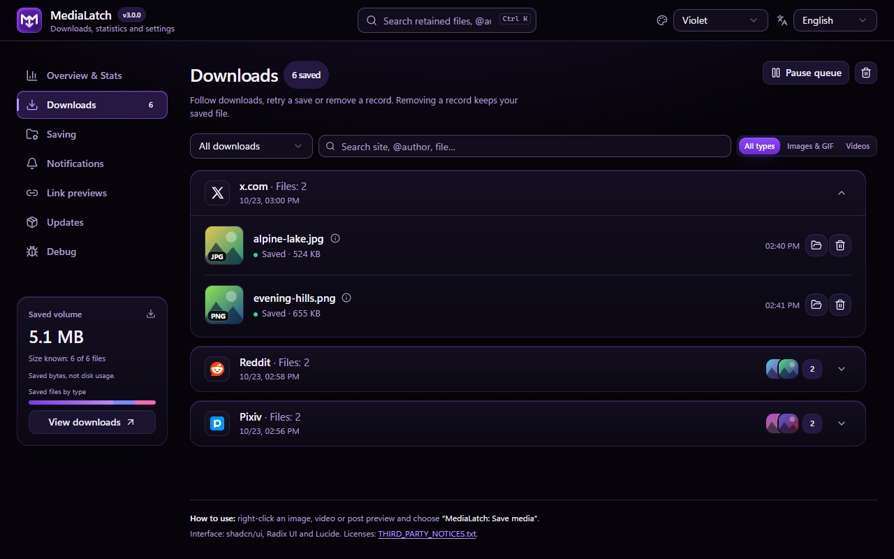
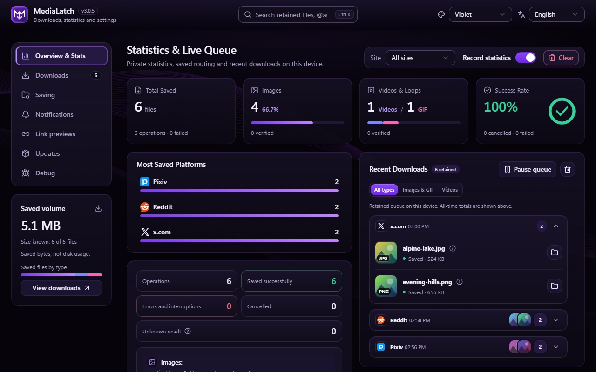
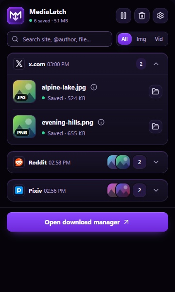
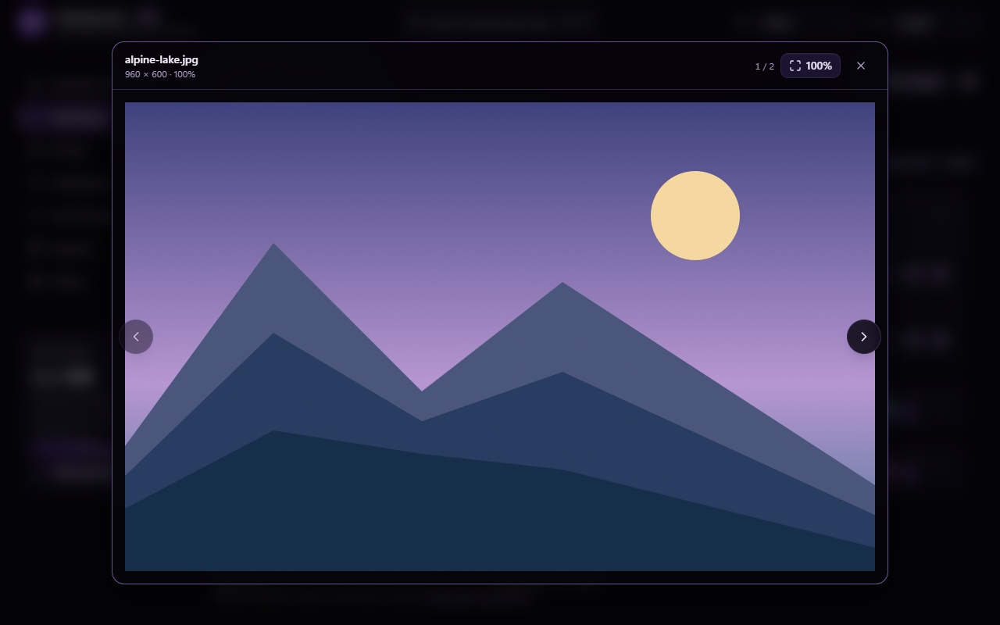

<div align="center">

<p align="center"></p>

[](https://chromewebstore.google.com/detail/medialatch/cimghidldpjhhhngdhigddjfpcofhbmh)

[](https://github.com/xhthc/MediaLatch/stargazers)
[](https://github.com/xhthc/MediaLatch/releases/tag/v3.0.4)
[](https://github.com/xhthc/MediaLatch)
[](docs/PRIVACY.md)
[](mailto:always1337@vk.com)
[](https://boosty.to/fs0x1337)
[](LICENSE)

[**🇷🇺 Русский**](README.md) | [**🇬🇧 English**](README.en.md)

</div>

<p align="center"></p>

> [!IMPORTANT]
> This repository contains MediaLatch documentation and packaged builds. Development source is private. **[Stable version 3.0.4](https://github.com/xhthc/MediaLatch/releases/tag/v3.0.4)** includes minified CRX and ZIP packages, separate checksums and a build file inventory.

> [!NOTE]
> **In 3.0.4:** the Red theme and motion across themes, compact previews for more platforms, site-styled Copy controls and synchronized paired buttons. Fullscreen, Pixiv/Bilibili ownership, toggles and settings panels are improved. [Project status](docs/STATUS.md) · [Roadmap](docs/ROADMAP.md).

To update an unpacked installation, finish downloads, replace files in its existing folder with ZIP 3.0.4 and click Reload for MediaLatch on the extensions page. Keep the extension installed. A GitHub release does not establish Chrome Web Store publication.

## ⚡ About

**MediaLatch** saves the images, videos and GIFs you select on a page. Use the browser menu or controls on supported sites, follow each file in the download manager, and open saved media in the built-in viewer.

Configure folders, names for new files, notices and optional statistics. No companion app is required. The extension has no backend or telemetry.

<p align="center"></p>

## 🚀 Installation and updates

<p align="center"></p>

Download **[ZIP 3.0.4](https://github.com/xhthc/MediaLatch/releases/download/v3.0.4/MediaLatch-3.0.4.zip)** for loading the unpacked extension, or [CRX 3.0.4](https://github.com/xhthc/MediaLatch/releases/download/v3.0.4/MediaLatch-3.0.4.crx) where browser policies permit. Each format has its own checksum: [ZIP SHA-256](https://github.com/xhthc/MediaLatch/releases/download/v3.0.4/MediaLatch-3.0.4.zip.sha256), [CRX SHA-256](https://github.com/xhthc/MediaLatch/releases/download/v3.0.4/MediaLatch-3.0.4.crx.sha256). [Build provenance](https://github.com/xhthc/MediaLatch/releases/download/v3.0.4/MediaLatch-3.0.4.provenance.json) describes the same 103 files in both packages. [All releases](https://github.com/xhthc/MediaLatch/releases).

For Chrome, use the [MediaLatch Chrome Web Store listing](https://chromewebstore.google.com/detail/medialatch/cimghidldpjhhhngdhigddjfpcofhbmh). Browser and enterprise policies restrict self-signed CRX installation. The store version is updated separately from GitHub.

If your browser permits manual CRX installation, download the package and checksum from the same release. Compare the file's SHA-256 with the published checksum before installing.

### ZIP and CRX_REQUIRED_PROOF_MISSING

1. Download the runtime ZIP above and verify its own SHA-256.
2. Extract it to a permanent folder.
3. Open `chrome://extensions`, enable Developer mode and click Load unpacked.
4. Select the folder containing `manifest.json`, not the ZIP file.

`CRX_REQUIRED_PROOF_MISSING` concerns required CRX proof: signing a package yourself does not guarantee installation in ordinary Chrome. A new private key does not replace that distribution policy. Google supports [loading unpacked extensions](https://developer.chrome.com/docs/extensions/get-started/tutorial/hello-world#load-unpacked) for local development; normal Chrome users install from the Web Store. The automatic **Source code** archive here is documentation, not the runtime. Keep the unpacked folder in place; automatic updates or data transfer between different IDs are not promised.

> [!TIP]
> Keep the checksum with the CRX. Switching installation channels can change the extension ID and local data. The private `.pem` signing key is not part of the package and is not needed by users.

Version 3.0.4 keeps the signing key and ID of the manual 3.0.0 build: `iahebdomfekhiofmdocjmdjpjlclnngd`. It differs from the earlier manually signed build with ID `kmebfblhgfacdonaomlggpkndcjjpkgd`: this package will not update that installation or automatically transfer its settings and history. Export needed data through the extension's available actions before switching installations.

Version 3.0.4 retains the 3.0.2 JSON statistics/history copies, larger preview cache, long-history search and earlier inline-control fixes. GIF encoding remains in a dedicated Worker; large GIFs still take time and resources. JavaScript is minified without source maps and remains inspectable in DevTools. See the [changelog](CHANGELOG.md) and [local-data behavior](docs/LOCAL_DATA.md).

## 🧩 Features

| Task | Available behavior |
| --- | --- |
| Save selected media | Original-image discovery, progressive MP4/WebM and supported GIFs. Exact signed URLs stay intact. |
| Save a post | Multiple files from posts on X, Reddit, Pixiv, Pawchive and supported VK pages. See each file's result and cancel the remaining downloads. |
| Choose a destination | Browser Downloads or an explicitly selected folder. Ordered levels, custom templates and one shared folder-name setting for Booru sites. |
| Name new files | Original basename or selected site/account and UTC publication date/time fields. Metadata-based names omit the CDN basename; unknown fields are skipped. |
| Preview saved media | Images, animated GIFs and MP4 with playback controls; fit/100%, zoom, pan, carousel buttons, arrow keys and swipe. |
| Track results | Popup, manager, page notices, optional statistics, retry and cancellation. Filters for images/GIFs and videos. |
| Copy preview links | 12 settings for X, Instagram, TikTok, YouTube videos/Shorts, Reddit, Pixiv, Bluesky, Threads, Twitch, Tumblr and Bilibili. Link conversion runs locally. |
| Adjust the interface | Violet, Red, Blue, Dark and Light themes; English/Russian; keyboard navigation and reduced motion. |
| Read release history | Browse release notes offline, with an Installed label on the matching version. |

Click a thumbnail in the manager to open the viewer. From the popup, it opens over the active tab; from a page notice, it opens over the source page. The viewer runs in an isolated extension frame. On restricted browser pages, it opens in the manager. Small previews appear on hover.

In 3.0.4 the local cache holds up to 2,048 thumbnails and 256 preview originals: 128 MiB per original, 512 MiB total and 30-day availability. If a file is too large or no longer cached, choose it from disk. The cache does not replace a backup or change saved files. Codec support depends on the browser.

### History and statistics

Open Overview → Local data and backups to export statistics and history as separate JSON files. Confirmed statistics restore replaces counters; history import adds missing records without starting downloads. Limits: 32 MiB UTF-8 per file and up to 50,000 history records per copy. Copies exclude media, source URLs and folder grants. History renders in windows while search covers the full retained list. [Details](docs/LOCAL_DATA.md).

### Folders and filenames

```text
Downloads/
└── SavedImages/
    ├── x/posting_account/Image/photo.jpg
    ├── reddit/posting_account/Videos/clip.mp4
    └── danbooru/uploader/Image/artwork.jpg
```

Choose folder levels in order: site, account, media type, extension, date, year–month or year. Custom templates are available; levels with unavailable metadata are skipped. Account folders are enabled separately for supported services. Matched Danbooru/Moebooru posts can use a verified uploader; artist tags do not become account identity.

Date and time fields in filenames use verified X post timestamps or matching Danbooru/Moebooru metadata, in UTC. These filename fields are omitted when publication time is unknown. Folder Date, Year–month and Year levels use publication time or, when unavailable, operation start time in UTC. Settings apply to new saves; existing files are not renamed.

Customize image, video and GIF folder labels independently for the `{type}` level. Defaults are `Image`, `Videos` and `GIF`; an empty field restores its default. Only the type level for new saves changes: custom labels, admitted job paths and existing files are preserved. Literal `Images` in a template remains one shared folder, not a media-type switch.

If the browser requests access to a saved folder again, use Restore folder access in settings. The selected destination stays saved. Completed browser downloads can show their file in its folder after verification. Direct chosen-directory exports explain the file-manager API limitation; no system companion is required.

When names match, the extension adds a suffix, even after history and statistics are cleared. Existing files are not overwritten. Long filenames may be shortened to fit path limits. The browser or filesystem may still reject an excessively long Windows path.

<details>
  <summary>Saving settings</summary>
  
</details>

<p align="center"></p>

## 🌐 From selection to file

<p align="center"></p>

The extension finds the selected media's original, checks the source and file, then saves it to the destination folder. It does not substitute a file from a neighboring post.

## 🌍 Site coverage

A site having Copy does not imply support for downloading its media. Twitch VODs retain their original address; playback, audio and galleries depend on the selected mirror and messenger. Reload already open site tabs after updating the extension.

Support depends on the selected media, page layout and your access to the source.

| Site or family | Scope |
| --- | --- |
| X / Twitter | Images and video, conversion of supported MP4 animations to GIF, and multiple files from a post. |
| Reddit | Images, native GIFs, declared progressive video and bounded unencrypted H.264/AAC HLS VOD. |
| Pixiv | The original of the selected artwork page or its verified page list; account folders. |
| RedGIFs | Selected images and player media, including supported separate-audio recovery. |
| VK / VK Video | Photos, supported carousels, collages and feed videos, preview cards, opened players and native clip downloads. Experimental; other layouts and audio need further testing. |
| TikTok / Instagram | Supported selected-video/Reel controls and posting usernames; separate-track-only feed sources can be unavailable. |
| Pawchive / Sankaku | Originals linked to the selected post. Incomplete archive imports are marked. |
| Booru families | Selected originals on supported engines, subject to authentication and site limits. |
| Other HTTP(S) pages | Image attributes, srcset, metadata and links to the selected image's original. There is no universal video search. |

DRM, live streams, universal HLS/DASH, arbitrary gallery selection and YouTube downloads are not supported. A 403, expired URL, missing original or unsupported stream is reported as a failure. Files from neighboring posts are not used as a fallback.

## 🖼️ Interface

Manager, statistics, popup and viewer screenshots show 3.0.0 with demonstration data; the separate Saving capture shows 3.0.1. Compatibility with real sites depends on their layout and access to the media.

<details open><summary>Download manager</summary>



</details>
<details><summary>Statistics, popup and viewer</summary>





</details>

<p align="center"></p>

## 🛡️ Privacy and security

MediaLatch has no backend or telemetry. Downloads contact the selected site, service or CDN. Settings, the queue, optional statistics, diagnostics and preview caches stay in extension storage. A manual version check contacts GitHub and does not install code.

Page notices show a short download result. Original file contents, folder access and local paths stay inside the extension. You can export reports and diagnostics manually; review the contents before sharing. HTTP/HTTPS permissions let the extension find selected media across sites. See the [privacy policy and permission explanations](docs/PRIVACY.md).

Report bugs, problems and vulnerabilities to [always1337@vk.com](mailto:always1337@vk.com) or [Issues](https://github.com/xhthc/MediaLatch/issues). Send vulnerability details and sensitive data by email. See the [Security Policy](SECURITY.md) for what to include and how to test.

## ☕ Support the project

Support development on [Boosty](https://boosty.to/fs0x1337). Send questions and feedback through [Issues](https://github.com/xhthc/MediaLatch/issues) or [email](mailto:always1337@vk.com).

## 📜 License

Starting with 3.0.0, project-owned code and artwork use the [proprietary license](LICENSE). Earlier GPL recipients keep their existing rights. Third-party components retain their [licenses and notices](THIRD_PARTY_NOTICES.txt).

Development source and its Git history are kept separately. The JavaScript inside a CRX can still be inspected after minification.

[Changelog](CHANGELOG.md) · [Privacy](docs/PRIVACY.md) · [Security Policy](SECURITY.md) · [Boosty](https://boosty.to/fs0x1337)

