<div align="center">

<p align="center"></p>

[](https://github.com/xhthc/MediaLatch/stargazers)
[](CHANGELOG.md)
[](https://github.com/xhthc/MediaLatch)
[](docs/PRIVACY.md)
[](https://t.me/fs0x1337)
[](https://boosty.to/fs0x1337)
[](LICENSE)

[**🇷🇺 Русский**](README.md) | [**🇬🇧 English**](README.en.md)

</div>

<p align="center"></p>

> [!IMPORTANT]
> Это публичный репозиторий документации и будущих готовых пакетов MediaLatch. Репозиторий разработки закрыт. **3.0.0 готовится к выпуску:** новый CRX появится после минификации, повторной упаковки и проверки.

## ⚡ О проекте

**MediaLatch** сохраняет выбранные изображения, видео и GIF со страницы. Меню браузера и кнопки на поддерживаемых сайтах запускают скачивание, менеджер показывает результат каждого файла, а встроенный просмотрщик открывает сохранённое медиа.

Папки, имена новых файлов, уведомления и статистика настраиваются. Дополнительная программа не нужна; собственного сервера и телеметрии у расширения нет.

<p align="center"></p>

## 🚀 Установка и обновления

<p align="center"></p>

Новые пакеты будут доступны в [Releases](https://github.com/xhthc/MediaLatch/releases). Вместе с CRX публикуются SHA-256 и сведения о составе сборки. **Сейчас публичный релиз 3.0.0 ещё не опубликован.**

Для обычного Chrome на Windows/macOS основной способ установки — Chrome Web Store. Самостоятельно подписанный CRX с GitHub не является универсальным установщиком: действуют правила браузера и управляемых установок. Ссылка на актуальную магазинную публикацию будет добавлена при её обновлении.

Изображённая выше загрузка распакованной папки предназначена для локальной проверки подготовленной сборки. Это отдельный режим разработчика, который требует самой проверенной папки.

> [!TIP]
> Сохраняйте контрольную сумму рядом с CRX. При ручной смене канала установки могут отличаться ID расширения и локальные данные. Закрытый ключ `.pem` не входит в пакет и не нужен пользователям.

## 🧩 Возможности

| Задача | Что доступно |
| --- | --- |
| Сохранить выбранное медиа | Поиск оригиналов изображений, прямые MP4/WebM и поддерживаемые GIF. Подписанные ссылки сохраняются целиком. |
| Скачать пост | Подтверждённые пакеты X, Reddit, Pixiv, Pawchive и поддерживаемых страниц VK; результат каждого файла и отмена оставшихся. |
| Выбрать папку | «Загрузки» браузера или папка, явно выбранная через диалог. Одна папка, разделение по сайтам и типам файлов. |
| Настроить новые имена | Исходное имя, необязательные сайт/аккаунт и дата/время публикации в UTC. Неизвестная дата пропускается. |
| Открыть сохранённое медиа | Изображения, анимированные GIF и MP4 с плеером; вписывание/100%, зум, перемещение, карусель с кнопками, клавиатурой и свайпом. |
| Следить за результатами | Компактный popup, менеджер, уведомления на странице, опциональная статистика, повтор и отмена. Фильтры изображений/GIF и видео сохранены. |
| Скопировать ссылку для превью | Настраиваемые ссылки X, Instagram, TikTok, обычных видео YouTube и Shorts. Скачивание YouTube не добавлено. |
| Изменить интерфейс | Фиолетовая, синяя, тёмная и светлая темы; русский/английский; фокус с клавиатуры и reduced motion. |
| Посмотреть изменения | Перелистывание включённых версий офлайн; установленная версия отмечена отдельно. |

Миниатюра в менеджере открывает просмотрщик поверх интерфейса. Из popup и уведомления он открывается поверх активной/исходной страницы в изолированном фрейме расширения; на системных страницах используется менеджер. Маленькое превью при наведении сохранено.

Кэш оригиналов локальный: до 64 МиБ на файл, 128 МиБ суммарно, 16 записей, 24 часа. Старый, слишком большой или вытесненный файл можно выбрать с диска. Отсутствие кэша не меняет скачанный файл. Кодеки зависят от браузера.

### Папки и имена

```text
Downloads/
└── SavedImages/
    ├── x/posting_account/pic/2026-10-22_18-35-12_original-name.jpg
    ├── reddit/video/clip.mp4
    └── pixiv/pic/artwork.png
```

Структура настраивается. Папка аккаунта относится к опубликовавшему медиа пользователю, который может не быть автором рисунка. Дата публикации сейчас определяется по подтверждённым данным поста X. Имя файла и время скачивания не подставляются вместо неизвестной даты. Настройка действует на новые сохранения; уже скачанные файлы не переименовываются.

Совпадающие имена получают суффикс, в том числе после очистки истории/статистики. Очистка записей не разрешает перезапись файлов. Длинные Unicode-имена могут сокращаться под ограничения пути; слишком глубокий путь Windows браузер или файловая система всё ещё могут отклонить.

<details>
  <summary>Настройки сохранения</summary>
  
</details>

<p align="center"></p>

## 🌐 Как проходит сохранение

<p align="center"></p>

Расширение связывает действие с выбранным медиа и исходной страницей, проверяет допустимый источник и файл, затем экспортирует его. Неподтверждённый оригинал соседнего поста не используется как замена.

## 🌍 Поддержка сайтов

Результат зависит от выбранного медиа, вёрстки страницы и вашего доступа к источнику.

| Сайт или семейство | Что поддерживается |
| --- | --- |
| X / Twitter | Изображения/видео, поддерживаемые MP4-анимации в GIF и подтверждённые пакеты поста. |
| Reddit | Изображения, обычные GIF, прямые видео и ограниченный незашифрованный H.264/AAC HLS VOD. |
| Pixiv | Оригинал выбранной страницы иллюстрации или её подтверждённый список страниц; папки аккаунтов. |
| RedGIFs | Медиа выбранного плеера, включая поддерживаемое восстановление отдельного звука. |
| VK / VK Video | Фото, поддерживаемые карусели/коллажи/видео ленты, карточки-превью, открытые плееры и штатное скачивание клипов. Экспериментально; другие варианты страниц и звук требуют проверок. |
| TikTok / Instagram | Поддерживаемые выбранные видео/Reels и аккаунты публикации; источники только с раздельными дорожками могут быть недоступны. |
| Pawchive / Sankaku | Объявленные оригиналы выбранного поста; неполный импорт архива обозначается отдельно. |
| Booru | Выбранные оригиналы поддерживаемых движков с учётом авторизации и ограничений сайта. |
| Другие HTTP(S)-страницы | Атрибуты изображения, srcset, связанные метаданные и ссылки на его оригинал с проверкой принадлежности. Универсального поиска видео нет. |

DRM, эфиры, универсальная загрузка HLS/DASH, произвольное выделение галереи и скачивание YouTube не поддерживаются. Ошибки 403, истёкшие ссылки, отсутствующий оригинал и неподдерживаемый поток показываются как сбой. Соседний пост не используется как запасной источник.

## 🖼️ Интерфейс

Снимки показывают подготовленный интерфейс 3.0.0 с локально созданными демонстрационными данными. Они не подтверждают работу всех живых сайтов.

<details open><summary>Менеджер загрузок</summary>


</details>
<details><summary>Статистика, popup и просмотрщик</summary>


</details>

<p align="center"></p>

## 🛡️ Приватность и безопасность

У MediaLatch нет собственного сервера и телеметрии. Скачивание обращается к выбранному источнику, сервису или CDN. Настройки, очередь, опциональная статистика, диагностика и превью хранятся в расширении. Ручная проверка версии обращается к GitHub и не устанавливает код.

Уведомления на странице содержат ограниченный текст результата. Оригинальные байты, права на папки и локальные пути остаются в контекстах расширения. Отчёты и экспорт диагностики требуют действия пользователя; проверяйте их перед отправкой. Доступ HTTP/HTTPS нужен для поиска выбранного медиа на разных сайтах. Подробнее: [политика приватности и разрешения](docs/PRIVACY.md).

О найденной уязвимости сообщайте приватно: [always1337@vk.com](mailto:always1337@vk.com) или [Telegram @fs0x1337](https://t.me/fs0x1337). Порядок сообщения и границы проверки описаны в [Security Policy](SECURITY.md).

## ☕ Поддержать проект

Если MediaLatch помогает собирать и хранить медиа, поддержать разработку можно на [Boosty](https://boosty.to/fs0x1337). Для вопросов и обычных ошибок — [Issues](https://github.com/xhthc/MediaLatch/issues) или [Telegram @fs0x1337](https://t.me/fs0x1337).

## 📜 Лицензия

С версии 3.0.0 собственный код и графика распространяются по [закрытой лицензии](LICENSE). Ранее полученные GPL-версии сохраняют прежние права. Сторонние компоненты сохраняют свои [лицензии и уведомления](THIRD_PARTY_NOTICES.txt).

Этот репозиторий не содержит исходников расширения или их Git-истории. CRX включает исполняемый JavaScript; упаковка и минификация не делают его недоступным для просмотра.

[Изменения](CHANGELOG.md) · [Приватность](docs/PRIVACY.md) · [Security Policy](SECURITY.md) · [Boosty](https://boosty.to/fs0x1337)
