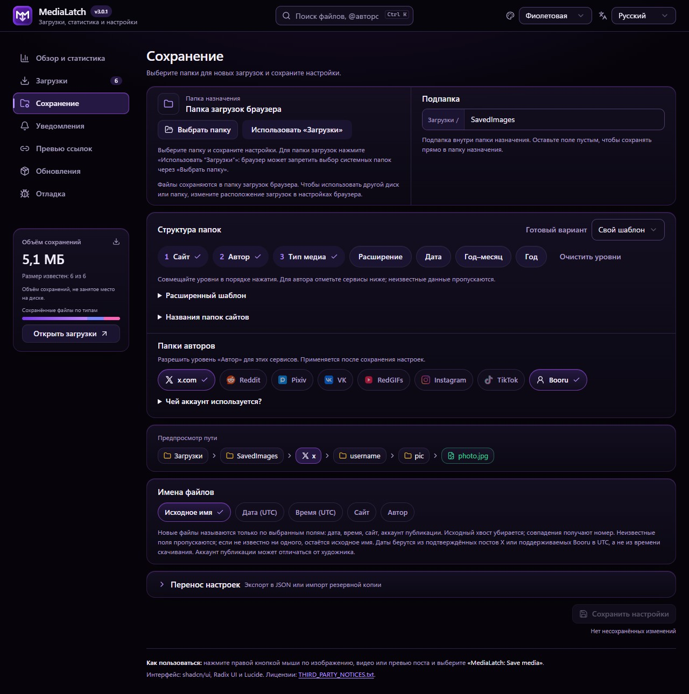
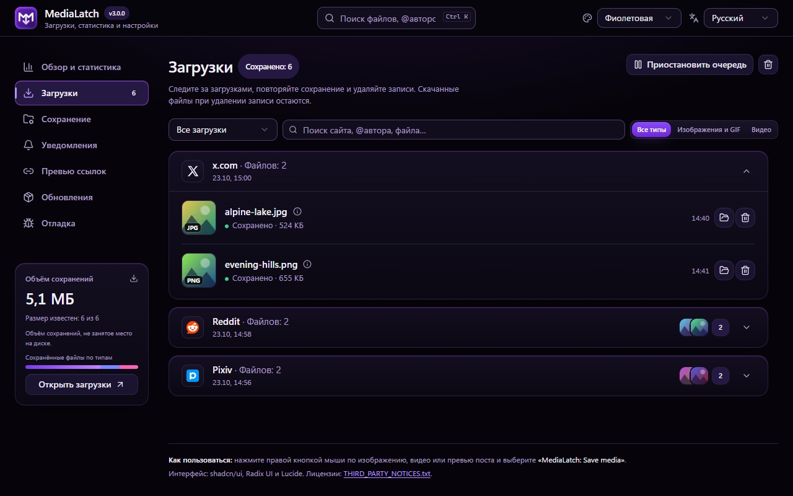
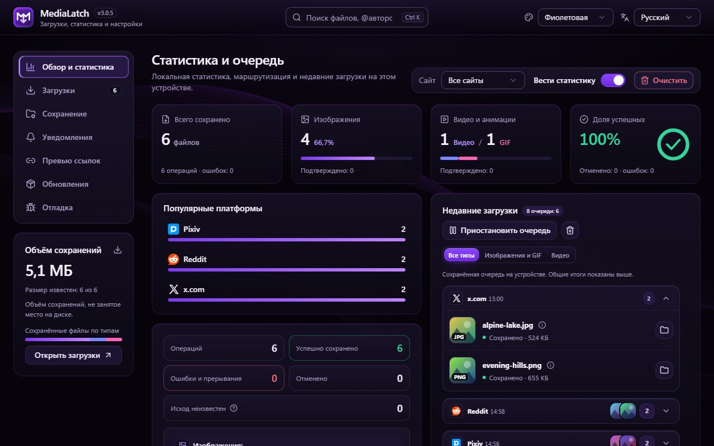
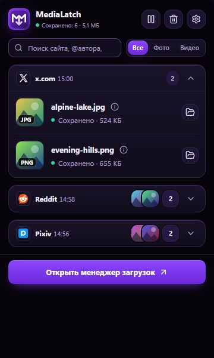
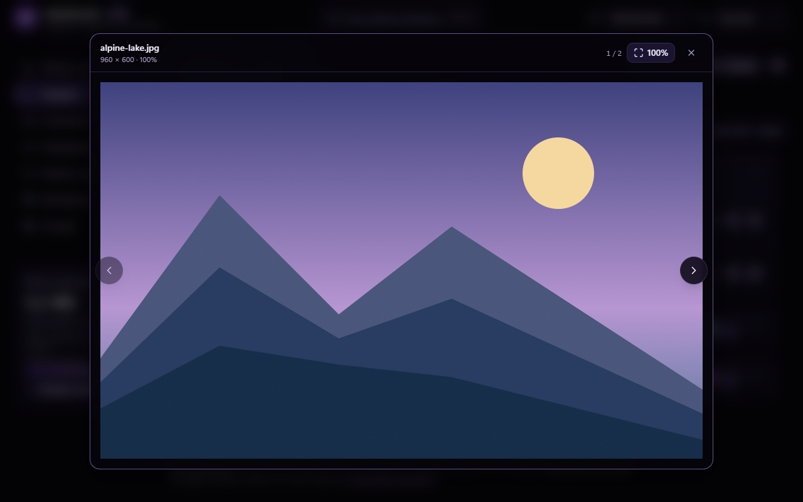

<div align="center">

<p align="center"></p>


[](https://github.com/xhthc/MediaLatch/stargazers)
[](https://github.com/xhthc/MediaLatch/releases/tag/v3.0.0)
[](https://github.com/xhthc/MediaLatch)
[](docs/PRIVACY.md)
[](mailto:always1337@vk.com)
[](https://boosty.to/fs0x1337)
[](LICENSE)

[**🇷🇺 Русский**](README.md) | [**🇬🇧 English**](README.en.md)

</div>

<p align="center"></p>

> [!IMPORTANT]
> Здесь находятся документация и готовые сборки MediaLatch. Исходники разработки закрыты. **[Стабильная версия 3.0.0](https://github.com/xhthc/MediaLatch/releases/tag/v3.0.0)** содержит минифицированный CRX, контрольную сумму и сведения о составе сборки.

## ⚡ О проекте

**MediaLatch** сохраняет выбранные изображения, видео и GIF со страницы. Меню браузера и кнопки на поддерживаемых сайтах запускают скачивание, менеджер показывает результат каждого файла, а встроенный просмотрщик открывает сохранённое медиа.

Папки, имена новых файлов, уведомления и статистика настраиваются. Дополнительная программа не нужна; собственного сервера и телеметрии у расширения нет.

<p align="center"></p>

## 🚀 Установка и обновления

<p align="center"></p>

Скачайте [MediaLatch 3.0.0.crx](https://github.com/xhthc/MediaLatch/releases/download/v3.0.0/MediaLatch-3.0.0.crx), [контрольную сумму SHA-256](https://github.com/xhthc/MediaLatch/releases/download/v3.0.0/MediaLatch-3.0.0.crx.sha256) и [сведения о сборке и её файлах](https://github.com/xhthc/MediaLatch/releases/download/v3.0.0/MediaLatch-3.0.0.provenance.json). История выпусков — в [Releases](https://github.com/xhthc/MediaLatch/releases).

В Chrome на Windows и macOS расширение обычно устанавливают через Chrome Web Store. Установку самостоятельно подписанного CRX ограничивают правила браузера и корпоративные политики. Ссылка на версию в магазине появится после обновления публикации.

Если браузер разрешает ручную установку CRX, скачайте пакет и контрольную сумму из одного релиза. Перед установкой сравните SHA-256 файла с опубликованной суммой.

> [!TIP]
> Сохраняйте контрольную сумму рядом с CRX. При ручной смене канала установки могут отличаться ID расширения и локальные данные. Закрытый ключ `.pem` не входит в пакет и не нужен пользователям.

ID этого CRX — `iahebdomfekhiofmdocjmdjpjlclnngd`. Он отличается от прежней ручной сборки с ID `kmebfblhgfacdonaomlggpkndcjjpkgd`: такой пакет не обновит её, а настройки и история автоматически не перенесутся. Перед сменой установки экспортируйте нужные данные через доступные действия расширения.

В 3.0.0 кодирование GIF вынесено в отдельный Worker, чтобы подготовка анимации не блокировала поток скрытого документа. Большие GIF всё ещё требуют времени и ресурсов. JavaScript минифицирован без sourcemaps; его можно изучить в DevTools. Полный список изменений — в [Changelog](CHANGELOG.md).

## 🧩 Возможности

| Задача | Что доступно |
| --- | --- |
| Сохранить выбранное медиа | Поиск оригиналов изображений, прямые MP4/WebM и поддерживаемые GIF. Подписанные ссылки сохраняются целиком. |
| Скачать пост | Несколько файлов из постов X, Reddit, Pixiv, Pawchive и поддерживаемых страниц VK. Результат виден для каждого файла; оставшиеся можно отменить. |
| Выбрать папку | «Загрузки» браузера или папка, явно выбранная через диалог. Одна папка, разделение по сайтам и типам файлов. |
| Настроить новые имена | Исходное имя, необязательные сайт/аккаунт и дата/время публикации в UTC. Неизвестная дата пропускается. |
| Открыть сохранённое медиа | Изображения, анимированные GIF и MP4 с плеером; вписывание/100%, зум, перемещение, карусель с кнопками, клавиатурой и свайпом. |
| Следить за результатами | Popup, менеджер, уведомления на странице, статистика по желанию, повтор и отмена загрузки. Фильтры изображений/GIF и видео. |
| Скопировать ссылку для превью | Настраиваемые ссылки X, Instagram, TikTok, обычных видео YouTube и Shorts. Скачивание YouTube не добавлено. |
| Изменить интерфейс | Фиолетовая, синяя, тёмная и светлая темы; русский/английский; фокус с клавиатуры и reduced motion. |
| Посмотреть изменения | История версий доступна без интернета; установленная версия отмечена отдельно. |

Нажмите на миниатюру в менеджере, чтобы открыть просмотрщик. Из popup он открывается поверх активной вкладки, из уведомления — поверх исходной страницы. Просмотрщик работает в изолированном фрейме расширения. На системных страницах он открывается в менеджере. При наведении доступно маленькое превью.

Оригиналы для превью хранятся локально: до 64 МиБ на файл, 128 МиБ суммарно, 16 записей, 24 часа. Если файл не поместился в кэш или уже удалён из него, выберите его с диска. Скачанный файл при этом не меняется. Поддержка кодеков зависит от браузера.

### Папки и имена

```text
Downloads/
└── SavedImages/
    ├── x/posting_account/pic/2026-10-22_18-35-12_original-name.jpg
    ├── reddit/video/clip.mp4
    └── pixiv/pic/artwork.png
```

Структура настраивается. Папка аккаунта относится к опубликовавшему медиа пользователю, который может не быть автором рисунка. Дата публикации сейчас определяется по подтверждённым данным поста X. Имя файла и время скачивания не подставляются вместо неизвестной даты. Настройка действует на новые сохранения; уже скачанные файлы не переименовываются.

При совпадении имён расширение добавляет суффикс, даже после очистки истории и статистики. Существующие файлы не перезаписываются. Длинные имена могут сокращаться из-за ограничений пути. Слишком длинный путь Windows браузер или файловая система могут отклонить.

<details>
  <summary>Настройки сохранения</summary>
  
</details>

<p align="center"></p>

## 🌐 Как проходит сохранение

<p align="center"></p>

Расширение ищет оригинал выбранного медиа, проверяет источник и файл, затем сохраняет его в папку. Файл из соседнего поста не используется как замена.

## 🌍 Поддержка сайтов

Результат зависит от выбранного медиа, вёрстки страницы и вашего доступа к источнику.

| Сайт или семейство | Что поддерживается |
| --- | --- |
| X / Twitter | Изображения и видео, преобразование поддерживаемых MP4-анимаций в GIF, загрузка нескольких файлов поста. |
| Reddit | Изображения, обычные GIF, прямые видео и ограниченный незашифрованный H.264/AAC HLS VOD. |
| Pixiv | Оригинал выбранной страницы иллюстрации или проверенный список её страниц; папки аккаунтов. |
| RedGIFs | Медиа выбранного плеера, включая поддерживаемое восстановление отдельного звука. |
| VK / VK Video | Фото, поддерживаемые карусели/коллажи/видео ленты, карточки-превью, открытые плееры и штатное скачивание клипов. Экспериментально; другие варианты страниц и звук требуют проверок. |
| TikTok / Instagram | Поддерживаемые выбранные видео/Reels и аккаунты публикации; источники только с раздельными дорожками могут быть недоступны. |
| Pawchive / Sankaku | Объявленные оригиналы выбранного поста; неполный импорт архива обозначается отдельно. |
| Booru | Выбранные оригиналы поддерживаемых движков с учётом авторизации и ограничений сайта. |
| Другие HTTP(S)-страницы | Атрибуты изображения, srcset, связанные метаданные и ссылки на его оригинал с проверкой принадлежности. Универсального поиска видео нет. |

DRM, эфиры, универсальная загрузка HLS/DASH, произвольное выделение галереи и скачивание YouTube не поддерживаются. Ошибки 403, истёкшие ссылки, отсутствующий оригинал и неподдерживаемый поток показываются как сбой. Соседний пост не используется как запасной источник.

## 🖼️ Интерфейс

На снимках показан интерфейс 3.0.0 с демонстрационными данными. Работа реальных сайтов зависит от их вёрстки и доступа к медиа.

<details open><summary>Менеджер загрузок</summary>



</details>
<details><summary>Статистика, popup и просмотрщик</summary>





</details>

<p align="center"></p>

## 🛡️ Приватность и безопасность

У MediaLatch нет собственного сервера и телеметрии. Скачивание обращается к выбранному источнику, сервису или CDN. Настройки, очередь, опциональная статистика, диагностика и превью хранятся в расширении. Ручная проверка версии обращается к GitHub и не устанавливает код.

Уведомления на странице показывают краткий результат загрузки. Содержимое оригиналов, права на папки и локальные пути остаются внутри расширения. Отчёт или диагностику можно экспортировать вручную; перед отправкой проверьте содержимое. Доступ HTTP/HTTPS нужен для поиска выбранного медиа на разных сайтах. Подробнее: [политика приватности и разрешения](docs/PRIVACY.md).

О багах, проблемах и уязвимостях сообщайте на [always1337@vk.com](mailto:always1337@vk.com) или в [Issues](https://github.com/xhthc/MediaLatch/issues). Подробности уязвимостей и чувствительные данные отправляйте на почту. Что приложить к сообщению и как проводить проверку, описано в [Security Policy](SECURITY.md).

## ☕ Поддержать проект

Поддержать разработку можно на [Boosty](https://boosty.to/fs0x1337). Для вопросов и обратной связи используйте [Issues](https://github.com/xhthc/MediaLatch/issues) или [почту](mailto:always1337@vk.com).

## 📜 Лицензия

С версии 3.0.0 собственный код и графика распространяются по [закрытой лицензии](LICENSE). Ранее полученные GPL-версии сохраняют прежние права. Сторонние компоненты сохраняют свои [лицензии и уведомления](THIRD_PARTY_NOTICES.txt).

Исходники разработки и их Git-история хранятся отдельно. JavaScript внутри CRX можно просмотреть и после минификации.

[Изменения](CHANGELOG.md) · [Приватность](docs/PRIVACY.md) · [Security Policy](SECURITY.md) · [Boosty](https://boosty.to/fs0x1337)
